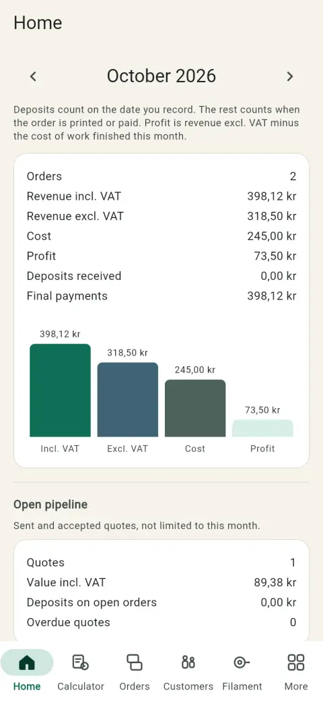
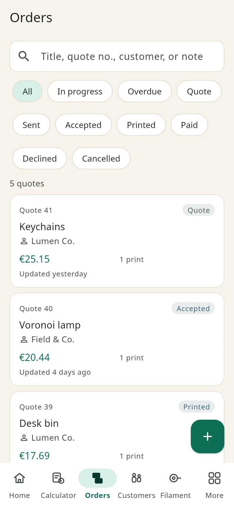
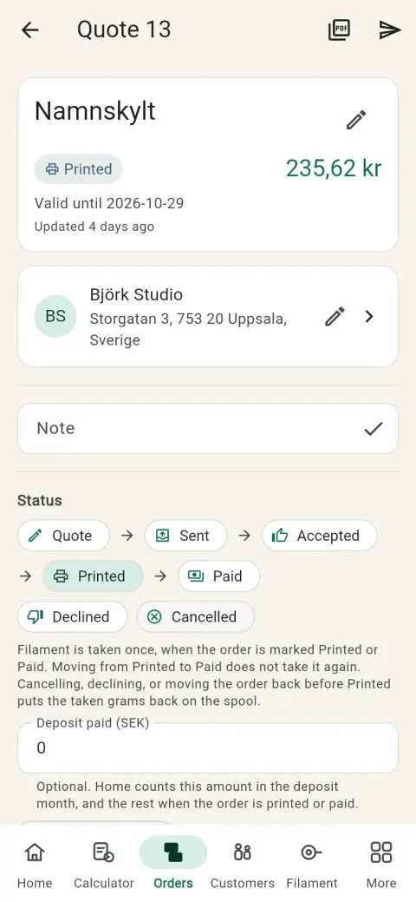
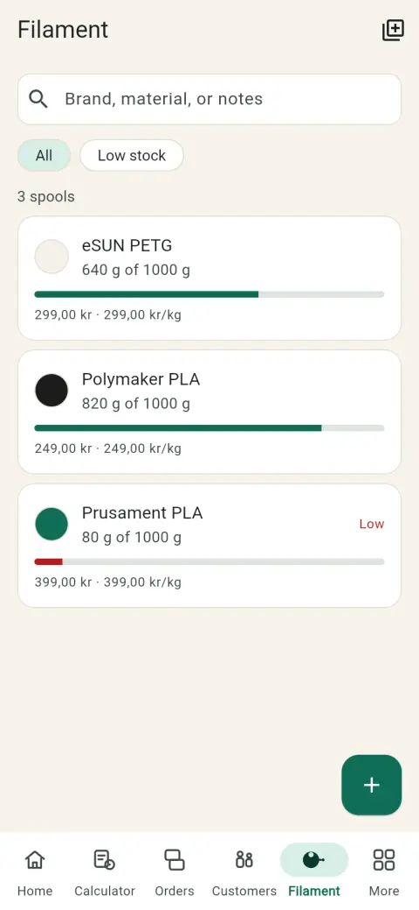

<p align="center">
  
</p>

# Gramnota

Räkna ut vad en 3D-utskrift ska kosta att sälja. Samma app på Android och på Windows.

## Ladda ner

Länkarna pekar alltid på den senaste versionen: [Gramnota – senaste versionen](https://github.com/Mahinika/gramnota/releases/tag/latest).

| Enhet | Fil |
| --- | --- |
| Telefon eller surfplatta | [](https://github.com/Mahinika/gramnota/releases/download/latest/Gramnota.apk) |
| Windows-dator | [](https://github.com/Mahinika/gramnota/releases/download/latest/Gramnota-Setup.exe) |
| Windows utan installation | [](https://github.com/Mahinika/gramnota/releases/download/latest/Gramnota-windows.zip) |

Direktlänkar, om knapparna inte syns:

- Android: https://github.com/Mahinika/gramnota/releases/download/latest/Gramnota.apk
- Windows, installationsprogram: https://github.com/Mahinika/gramnota/releases/download/latest/Gramnota-Setup.exe
- Windows, zip-fil: https://github.com/Mahinika/gramnota/releases/download/latest/Gramnota-windows.zip

### Android

1. Ladda ner `Gramnota.apk`.
2. Öppna filen. Om telefonen frågar, tillåt installation från den här källan (okända källor).
3. Öppna Gramnota och logga in med Google.

### Windows

1. Ladda ner `Gramnota-Setup.exe`.
2. Om Windows visar ”Windows skyddade datorn”: välj **Mer information** och sedan **Kör ändå**. Appen är inte kodsignad, så rutan kan komma första gången.
3. Installationsprogrammet lägger Gramnota i `C:\Program Files\Gramnota`, skapar en genväg i Start-menyn och (om rutan är ikryssad) på skrivbordet. En nyare version uppgraderar den som redan är installerad, på samma plats. Windows frågar efter administratörsrättighet.
4. Starta Gramnota. Inloggningen öppnas i webbläsaren. Logga in med Google och gå tillbaka till appen.

Avinstallera senare under Windows-inställningar, Appar.

En installerad app letar efter en ny version ungefär en gång om dagen. Knappen **Sök efter uppdateringar** finns under More och under Settings. Android ber dig bekräfta installationen i systemets egen ruta. På Windows stängs appen, installationsprogrammet körs, och Gramnota öppnas igen.

Zip-filen är samma program utan installation. Packa upp den och kör `gramnota.exe`. Samma SmartScreen-ruta kan visas första gången. Visual C++-biblioteken följer med, så en vanlig Windows 10- eller 11-dator behöver inget extra.

## Vad du kan göra

- Räkna ut ett pris med filament, el, maskinslitage, felmarginal, arbete, tillägg, påslag och moms.
- Lägga flera utskrifter på samma offert, med ett totalpris.
- Spara kunder, filamentrullar, skrivare och produkter du offererar ofta.
- Dra filament från rullen när en order markeras som utskriven eller betald. Avbryter du innan dess läggs grammen tillbaka.
- Dela en PDF-offert.
- Se månadens intäkter, handpenningar och lågt lager på hemskärmen.
- Klistra in en länk till en modell, eller importera G-code, så fylls tid och vikt i när sidan publicerar dem. Priset räknas ändå från dina egna rullar.

## Så ser appen ut

<p>
  
  
  
  
</p>

All rights reserved.

---

## För utvecklare

Gramnota is a Flutter app (`gramnota`) for Android and Windows. The UI of the app is English. The default currency is SEK. Money is integer minor units (öre): `100` minor is one currency unit.

A quote can include filament, electricity, machine wear, a failure buffer, labor, extras, markup, and VAT. One quote can hold several different prints, with one total and one stock deduction. Customers, filament spools, printers, and a product catalog stay with the signed-in user. Marking an order Printed or Paid takes filament out of stock once. Cancelling or moving it back before Printed puts those grams back. A PDF quote can be shared from the order. Home shows the month: revenue, deposits, open quotes, and low stock.

### Firebase

The app compiles before Firebase is connected and shows a setup screen until `lib/firebase_options.dart` has real keys.

1. Create a Firebase project, enable Google sign-in, and create a Firestore database.
2. `dart pub global activate flutterfire_cli`
3. `flutterfire configure` (this overwrites `lib/firebase_options.dart` and writes `android/app/google-services.json`).
4. Register **both** Android SHA-1 fingerprints on the Firebase Android app (`se.gramnota.app`):
   - **Debug** — `cd android` then `./gradlew signingReport` (or Android Studio signing report).
   - **Upload / release** — the certificate used for `android/app/upload-keystore.jks` when `android/key.properties` exists (GitHub APK builds use this key).
5. Download a fresh `google-services.json` so it lists an OAuth Android client for each SHA-1 you use.
6. Deploy rules: `firebase deploy --only firestore:rules` using [firestore.rules](firestore.rules).

`google-services.json`, `android/key.properties`, and `*.jks` are gitignored. The checked-in `firebase_options.dart` is not a secret; replace it with the file FlutterFire generates. Include both the Android and Windows apps when you configure Firebase. Do not commit keystores or paste secret values into this file.

On Android, sign-in uses the Google Sign-In plugin. On Windows, sign-in opens your browser. Continue with Google there, then return to Gramnota.

### Run

```
flutter run -d android
flutter run -d windows
```

### Local Firebase emulators

The Auth and Firestore emulators let you walk the app without Google sign-in. Production builds do not use them. Install the [Firebase CLI](https://firebase.google.com/docs/cli), then from the repo root:

```
firebase emulators:start --only auth,firestore
```

In another terminal:

```
flutter run -d chrome --dart-define=USE_FIREBASE_EMULATOR=true
```

The same flag works with `-d windows` or a web server. The sign-in screen then offers **Sign in as test seller** (`seller@gramnota.test`). That account is created on the Auth emulator the first time you use it. A browser refresh signs you out (emulator persistence is off) but keeps talking to the emulators, including when the page is opened at `127.0.0.1`. Sign in as the test seller again. The emulator UI is at http://127.0.0.1:4000. Rules from [firestore.rules](firestore.rules) apply. In the browser build, Google sign-in is not available; use the test seller button.

### Releases

Every push to `master` builds a release APK ([android-apk.yml](.github/workflows/android-apk.yml)) and a Windows installer ([windows-release.yml](.github/workflows/windows-release.yml)). Both publish on the **`latest`** release, with stable file names:

- https://github.com/Mahinika/gramnota/releases/download/latest/Gramnota.apk
- https://github.com/Mahinika/gramnota/releases/download/latest/Gramnota-Setup.exe
- https://github.com/Mahinika/gramnota/releases/download/latest/Gramnota-windows.zip

[`.github/scripts/publish_release.sh`](.github/scripts/publish_release.sh) uploads only that job's files, deletes renamed leftovers from the same platform (so a version bump does not leave `Gramnota-Setup-1.0.0.exe` next to `Gramnota-Setup.exe`), and rewrites only that platform's version line. A lock in the release body keeps the two jobs from saving a stale copy over each other when they finish together. You can also start a build from the Actions tab.

Each master build keeps the version name from `pubspec.yaml` (`1.0.0`) and sets the build number from `github.run_number`, so a newer build is detectable. The same publish step writes [`latest.json`](https://github.com/Mahinika/gramnota/releases/download/latest/latest.json) on that release: version, build, commit, date, Swedish notes, the public APK and installer URLs, and a sha256 for each file. The two jobs merge their own platform block and leave the other one in place. The app reads that public URL. There is no download token. A local build can point somewhere else with `--dart-define=UPDATE_MANIFEST_URL=...`.

The APK job needs the repository secrets `GOOGLE_SERVICES_JSON`, `ANDROID_KEYSTORE_BASE64`, `ANDROID_KEYSTORE_PASSWORD`, and `ANDROID_KEY_PASSWORD`. The Windows job does not read repository secrets: Windows Firebase settings are already in `lib/firebase_options.dart`.

The older [`android`](https://github.com/Mahinika/gramnota/releases/tag/android) and [`windows`](https://github.com/Mahinika/gramnota/releases/tag/windows) releases are no longer replaced. Their notes point at `latest`. `app-release.apk`, `Gramnota-Setup-1.0.0.exe`, and `Gramnota-1.0.0-windows-x64.zip` stay on those releases so existing links do not 404.

If you change the upload keystore, register the new SHA-1/SHA-256 in Firebase, refresh `GOOGLE_SERVICES_JSON`, and uninstall the old APK before installing the new one (Android treats a new signature as a different app).

The Windows installer asks for administrator permission, installs to `C:\Program Files\Gramnota`, and upgrades in place. `Gramnota-windows.zip` is the same build as a folder. Both include the Visual C++ runtime libraries next to `gramnota.exe` (`msvcp140.dll`, `vcruntime140.dll`, `vcruntime140_1.dll`, and the other runtime DLLs from the build).

### Model links

Paste a link, or on Android share it into the app.

- MakerWorld, Printables, and Creality Cloud fill the title, print time, and filament grams.
- Thingiverse, Thangs, Cults3D, MyMiniFactory, Makeronline, Nexprint, and GrabCAD fill the title when the page publishes one, and say that time and weight were not published. If that page links to MakerWorld, Printables, or Creality Cloud, Gramnota follows that link once.
- The price still comes from your own spools.

### G-code and 3MF

On the calculator, **Import G-code** reads a `.gcode` or `.3mf` file. Gramnota scans the start and end of the file for slicer comments, so a large toolpath is not loaded into memory. PrusaSlicer, OrcaSlicer, Bambu Studio, Cura, and Creality Print supply print time and filament grams, including one row per extruder when the file lists them. A `.3mf` is used when it contains sliced G-code or plate metadata (Bambu Studio and OrcaSlicer write those into the archive). When that file has several plates, Gramnota asks whether to import all of them as separate prints on the quote, or to fill the form from one plate. The sale price still comes from your spools.

On Android you can share a link, or a file whose type is G-code or 3MF, into Gramnota. It opens on the calculator. Gramnota does not register for every `application/octet-stream` share. Android does not reliably filter those shares by file name (the path is an extra, not the intent data), so a broad binary type would offer Gramnota for unrelated files. File managers that only advertise `application/octet-stream` will not list Gramnota; share the file as G-code or 3MF, or import it from the calculator.

### Duplicate a quote

On a quote, **Duplicate as new quote** copies the prints, the customer, and the print settings. The copy is a Quote with a new number and new dates. Filament already taken out of stock stays on the original order. Prices are calculated again from the current spool prices, printer costs, electricity price, and labor rate. Markup, failure, and VAT stay as they are on each print.

### Product catalog

**More → Products** stores a print you quote again: time, filaments, printer, labor minutes, extras, and percents. Save one from the calculator (**Save as product**) or from a print on a quote. **Add from catalog** on the calculator, or **Add product** on a quote, inserts it and prices filament, electricity, and machine wear from the spools, printer, and workshop rates you have at that moment. Markup, failure, and VAT stay as saved on the product.

Each print keeps the catalog product's id. Home's top products follow that id, so renaming the product or the print title does not split the ranking. Quotes saved before this id existed are grouped by title.

### Quote status

An order moves Quote → Sent → Accepted → Printed → Paid. Declined and Cancelled are the other exits. The order list has a chip for each status, plus All, In progress (everything that is not Paid, Declined, or Cancelled), and Overdue.

Filament leaves the spool when the order first becomes Printed or Paid. Changing Printed to Paid does not take filament again. Cancelling, declining, or moving the order back before Printed returns the grams that were actually taken, including when the spool was short. Older orders stored as Delivered open as Paid, with their stock and totals unchanged.

A deposit is optional. Pick the date it was received; if you leave the date empty, saving a deposit uses today. Until the order is Paid, the quote shows what is still to pay. The customer PDF lists the deposit, its date, and the balance when a deposit is set.

A Quote or Sent order shows Overdue the day after its valid-until date. The Overdue filter lists those quotes. Home counts them as well.

### Home

**Home** is the month view. A deposit counts in the month of its date. The rest of a Printed or Paid order counts in the month the work was first finished, so the deposit and the final payment can fall in different months. An older order with a deposit but no date keeps the whole total in the finish month. Profit is that month's revenue excl. VAT minus the cost of work finished in the month. The month follows the device calendar, so an order just before local midnight stays in that month. Sent and Accepted quotes, deposits still sitting on open orders, and overdue quotes are not limited to the month. The page also lists filament grams by material, top customers, top products, and spools at or under their warning threshold. Amounts in SEK, NOK, and DKK use a comma for öre and a space between thousands.

### Stock warnings

Settings has a workshop low-stock warning, 100 g unless you change it. A spool can follow that default or keep its own threshold. The filament list and Home mark a spool that is at or under the threshold.

On a quote, Gramnota warns when the chosen spools cannot cover grams times quantity, plus the same sum on other Accepted quotes that have not taken stock yet. The warning is shown before the order is marked Printed. You can still print it; a short spool only deducts what is left.
