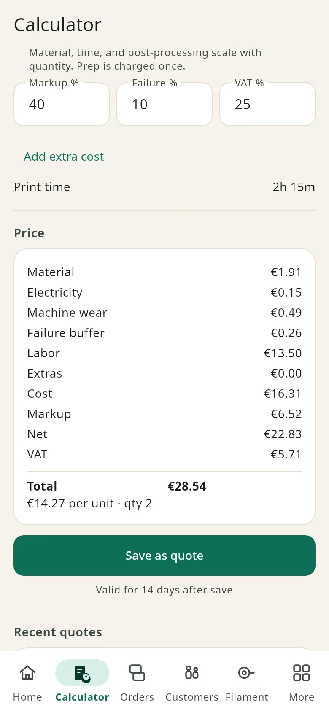
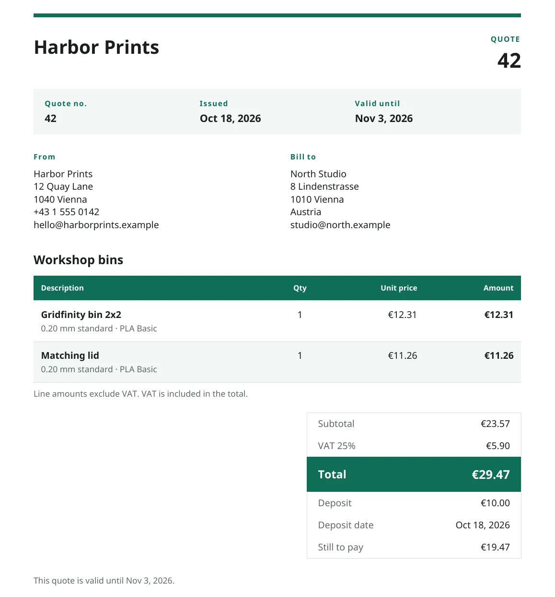
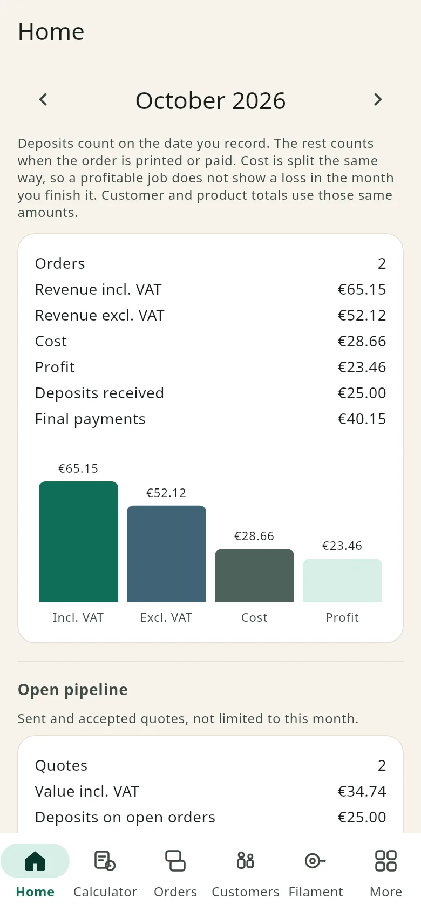
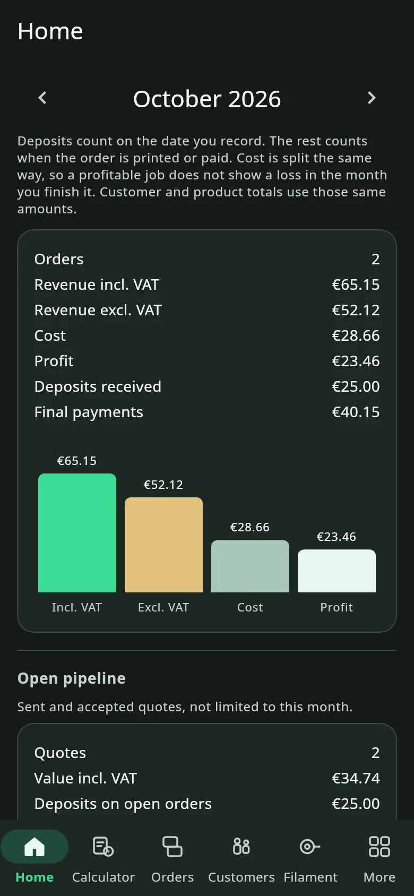
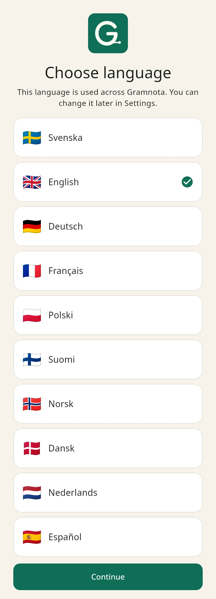

<p align="center">
  
</p>

<h1 align="center">Know what every print really costs</h1>

<p align="center">
  Price a 3D print from filament, power, and your time, then send a pro quote in a minute.<br>
  Free, with no ads. The same workshop on Android and Windows, synced with your Google account.
</p>

<p align="center">
  <a href="https://github.com/Mahinika/gramnota/releases/download/latest/Gramnota.apk"></a>
  &nbsp;
  <a href="https://github.com/Mahinika/gramnota/releases/download/latest/Gramnota-Setup.exe"></a>
  &nbsp;
  <a href="https://github.com/Mahinika/gramnota/releases/download/latest/Gramnota-windows.zip"></a>
</p>

<p align="center">
  <a href="https://github.com/Mahinika/gramnota/releases/tag/latest">Latest version</a>
  ·
  <a href="https://discord.gg/32c8gzgWcS"></a>
</p>

Direct links, if the buttons do not show:

- Android: https://github.com/Mahinika/gramnota/releases/download/latest/Gramnota.apk
- Windows installer: https://github.com/Mahinika/gramnota/releases/download/latest/Gramnota-Setup.exe
- Windows zip: https://github.com/Mahinika/gramnota/releases/download/latest/Gramnota-windows.zip

On Android, open the APK. If your phone asks, allow installation from this source.

The Windows installer is unsigned, so SmartScreen can say “Windows protected your PC” the first time. Choose **More info**, then **Run anyway**. It installs to `C:\Program Files\Gramnota` and can upgrade a copy that is already there. The zip is the same app without an install: unpack it and run `gramnota.exe`. That file can show the same SmartScreen note once. A normal Windows 10 or 11 PC needs nothing extra.

The installed app looks for a new version about once a day. **Check for updates** is under More and under Settings. Android asks you to confirm the install. On Windows the app closes, the installer runs, and Gramnota opens again.

## A look at the app

<p align="center">
  
  
</p>

<p align="center">
  
  
  
</p>

<p align="center">
  
  
</p>

## Why Gramnota

- The sale price includes the costs that are easy to skip: electricity, machine wear, a failure buffer, and your time, then markup and VAT.
- The PDF your customer gets looks like an invoice: your workshop, their name, the prints, VAT, and the total.
- Your phone and your PC share one workshop when you sign in with the same Google account.
- Free to use, with no ads. Export a backup, or delete the account, from Settings.

## What you can do

- Price one print or several prints on the same quote. Quantity scales material, power, machine wear, the failure buffer, and production labor. Prep is charged once. Post-processing is charged per piece. Extras stay a flat amount.
- Paste a MakerWorld, Printables, or Creality Cloud link and fill the title, print time, and grams when the page publishes them. Thingiverse, Thangs, Cults3D, MyMiniFactory, Makeronline, Nexprint, and GrabCAD can fill the title. The price still comes from your own spools.
- Import `.gcode` or `.3mf` from PrusaSlicer, OrcaSlicer, Bambu Studio, Cura, or Creality Print. A file with several plates can become several prints on the quote, or fill the form from one plate. On Android you can also share a link or a slice file into the app.
- Save a print you quote often in the product catalog, and add it again later. **Duplicate as new quote** copies a job, gives it a new number, and recalculates the price from today’s spools and rates. Markup, failure, and VAT stay as they were.
- Move a job through Quote, Sent, Accepted, Printed, and Paid. Declined and Cancelled are the other exits. Record a deposit and the date it arrived; until the job is paid, the quote shows what is still to pay. A Quote or Sent job is overdue the day after its valid-until date.
- Filament leaves the spool once, when the job is first marked Printed or Paid. Moving between those two does not take it again. Cancelling, declining, or moving it back returns the grams that were actually taken.
- Home is the month: revenue, profit, deposits, open quotes, overdue quotes, filament used, and your top customers and products.
- A spool warns when it is at or under its own threshold, or the workshop default. A quote also warns when accepted jobs plus this one need more grams than you have left. You can still print; a short spool only deducts what remains.
- Customer PDFs in Swedish, English, German, Norwegian, Danish, Finnish, French, Spanish, Polish, and Dutch. Quotes can be in euros, dollars, pounds, kronor, zloty, francs, and most other everyday currencies. Each quote keeps the currency it was saved with. Amounts are not converted.
- Appearance follows the device, or you can pick Light or Dark. The first screen asks for a language, before sign-in. Setup after that is a printer, an optional standard spool, and your electricity price. Business name, labor, markup, and VAT live in Settings.
- Export or import the workshop as one JSON file: settings, printers, spools, customers, quotes, and products.

## Get started in 3 steps

1. Download the Android APK or the Windows installer above. Use the zip if you would rather not install.
2. Open Gramnota, choose your language, and sign in with Google. On Windows, sign-in opens in the browser and then returns to the app.
3. Add your printer. A standard spool and your electricity price are the next two short steps. You land on the calculator.

## FAQ

### Is Gramnota free?

Yes. There is no subscription and there are no ads.

### Where does my data live?

Your workshop is stored under your Google sign-in, in a private space in Gramnota’s database (Cloud Firestore). Only that account can read and change your quotes, customers, spools, and printers. Settings can export a JSON backup, and **Delete account** removes the workshop data and the Gramnota sign-in.

### Is it safe to run on Windows?

The installer is unsigned, which is why SmartScreen asks the first time. Choose **More info**, then **Run anyway**. Sign-in uses Google in your browser. The workshop on the PC is the same private data as on the phone.

### Does it work offline?

The first sign-in needs internet. After that, Gramnota keeps a copy of the workshop on the device, so you can open it and keep working without a connection. Changes sync when the phone or PC is online again.

### Which slicers can I import from?

PrusaSlicer, OrcaSlicer, Bambu Studio, Cura, and Creality Print, as `.gcode` or as a `.3mf` that already contains the slice. Gramnota reads the slicer summary at the ends of the file. The sale price still comes from the spools you entered.

## Community

<p>
  <a href="https://discord.gg/32c8gzgWcS"></a>
</p>

The [Gramnota Discord](https://discord.gg/32c8gzgWcS) is the place for help, bugs, and ideas. A [GitHub issue](https://github.com/Mahinika/gramnota/issues) works too.

All rights reserved.

---

## For developers

Gramnota is a Flutter app (`gramnota`) for Android and Windows. UI strings are in `lib/l10n`. Money is integer minor units (`100` minor is one currency unit). Percents are basis points (`10000` is 100%).

```
flutter pub get
flutter analyze
flutter test
flutter run -d android
flutter run -d windows
```

An unconfigured build shows a setup screen and does not touch Firebase. To connect your own project: enable Google sign-in and Firestore, then `flutterfire configure`. Register both the debug SHA-1 and the upload-keystore SHA-1 on the Android app `se.gramnota.app`, and keep both OAuth clients in `google-services.json`. Rules are in [firestore.rules](firestore.rules). Do not commit `google-services.json`, `android/key.properties`, or keystores.

Every push to `master` publishes the three download files on the [latest](https://github.com/Mahinika/gramnota/releases/tag/latest) release. The README gallery is regenerated with `GRAMNOTA_SCREENSHOTS=1 flutter test test/readme_screenshots_test.dart`.
